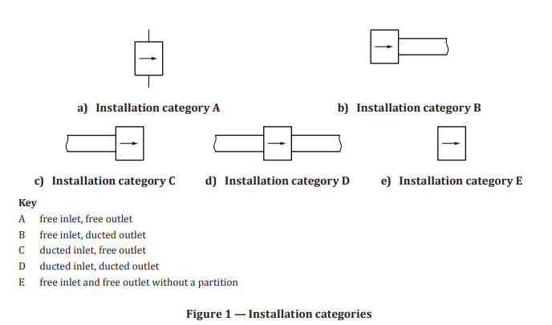
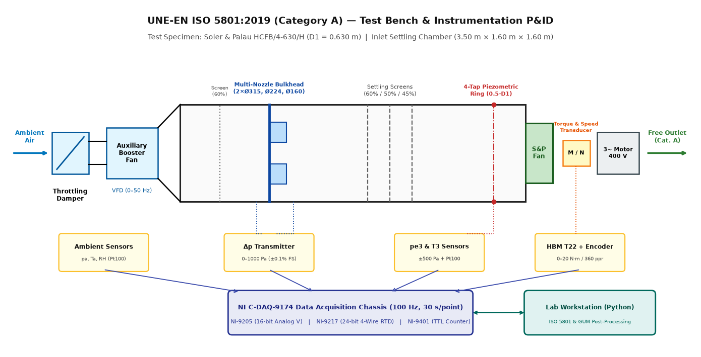

# Aerodynamic Characterization and Experimental Test Bench Design for an Axial Fan (UNE-EN ISO 5801:2019)

**Release:** 1.0 — Experimental Methodology, Instrumentation & Normative Application  
**Subject:** Advanced Fluid Dynamics Design Project  
**Reference Standard:** UNE-EN ISO 5801:2019 (*Fans — Performance testing using standardized airways*)

---

## 1. Introduction and Scope

The objective of this secction is to design, size, and validate a standardized aerodynamic test bench for the experimental characterization of a commercial wall-mounted axial fan, the **Soler & Palau HCFB/4-630/H**, in full compliance with **UNE-EN ISO 5801:2019** [1].

In turbomachinery testing, the measured performance curve of an axial fan depends heavily on the upstream and downstream flow boundary conditions (inlet swirl, velocity profile distortion, and back-pressure recovery). Consequently, **ISO 5801:2019** defines four standardized installation categories (Categories A, B, C, and D) to guarantee reproducible laboratory measurements [1]. Because the **HCFB/4-630/H** is an un-ducted plate-mounted axial fan designed to draw air from an open space and discharge directly into the atmosphere, it corresponds to **Installation Category A (Free Inlet, Free Outlet)** [1, 2].

        
        Figure 1. Fan Categories from ISO 5801:2019 [1]

To achieve a full performance map — from **shut-off** ($q_V = 0\ \mathrm{m^3/s}$) to **free delivery** ($p_{fs} = 0\ \mathrm{Pa}$) — while keeping measurement uncertainties within the mandatory tolerances of **ISO 5801:2019 Table 13**, **Release 1** establishes:
1. **Relevant Physical and Dimensionless Variables:** Governing geometric, thermodynamic, aerodynamic, and mechanical variables of the axial fan.
2. **Instrumentation and Data Acquisition (DAQ) Architecture:** Sensor selection, calibration tolerances, signal conditioning, and uncertainty propagation according to ISO/IEC Guide 98-3 (GUM) [3].
3. **Normative Application of ISO 5801:2019:** Engineering sizing of the Category A inlet-side settling chamber (Clause 9.4), multi-nozzle flowmeter bank (Clause 13.3), and hybrid operating-point control system.

### 1.1 Reference Test Specimen Specifications

The nominal geometric and operating parameters of the tested axial fan, obtained from the manufacturer's technical datasheet [2], are summarized in Table 1.

| Parameter | Symbol | Nominal Value | Unit | Notes / Source |
| :--- | :---: | :---: | :---: | :--- |
| **Fan Model** | — | S&P HCFB/4-630/H | — | Plate-mounted axial fan, 4-pole motor [2] |
| **Impeller Diameter** | $D_1$ | $0.630$ | $\mathrm{m}$ | Reference aerodynamic diameter [1, 2] |
| **Reference Inlet Area** | $A_1$ | $0.3117$ | $\mathrm{m^2}$ | $A_1 = \frac{\pi}{4} D_1^2$ [1] |
| **Nominal Rotational Speed** | $N_0$ | $1380$ | $\mathrm{rpm}$ | Angular velocity $\omega_0 = 144.51\ \mathrm{rad/s}$ [2] |
| **Maximum Volumetric Flow Rate** | $q_{V,\max}$ | $4.79$ | $\mathrm{m^3/s}$ | Free delivery ($p_{fs} = 0\ \mathrm{Pa}$, $\rho_0 = 1.20\ \mathrm{kg/m^3}$) [2] |
| **Maximum Absorbed Power** | $P_{\max}$ | $1.35$ | $\mathrm{kW}$ | Nominal three-phase $400\ \mathrm{V} / 50\ \mathrm{Hz}$ rating [2] |
| **Installation Category** | — | Category A | — | Free inlet, free outlet (ISO 5801 Clause 9.4) [1] |

---

## 2. Relevant Variables of the Axial Fan

Following **ISO 5801:2019 (Clauses 3, 5, and 15)** [1] and classical turbomachinery similarity theory [4, 5], the complete set of variables required to describe the steady-state aerodynamic and energetic behavior of the axial fan is grouped into five physical domains.

### 2.1 Geometric Variables
* **Impeller Tip Diameter ($D_1\ [\mathrm{m}]$):** Outer swept diameter of the rotor blades ($D_1 = 0.630\ \mathrm{m}$), used as the primary characteristic length scale for all area, velocity, and dimensionless calculations [1].
* **Fan Reference Area ($A_1\ [\mathrm{m^2}]$):** Conventional cross-sectional area defined by the impeller diameter:
  $$A_1 = \frac{\pi D_1^2}{4}$$
* **Secondary Geometric Ratios (Fixed for a given machine):** Hub-to-tip diameter ratio ($\nu = D_{\mathrm{hub}}/D_1$), number of blades ($Z$), blade pitch angle ($\beta$), and radial tip clearance ($\delta_{\mathrm{tip}}/D_1$). Under geometric similarity, these ratios remain constant during testing [4].

### 2.2 Ambient & Thermodynamic Working-Fluid Variables
Because air density varies with laboratory weather conditions, **ISO 5801:2019 (Clause 12.2)** requires simultaneous measurement of three ambient state variables to compute humid air density $\rho$ [1]:
* **Barometric Ambient Pressure ($p_a\ [\mathrm{Pa}]$):** Absolute atmospheric pressure inside the test laboratory.
* **Ambient Dry-Bulb Temperature ($T_a\ [\mathrm{^\circ C}]$ or $\Theta_a\ [\mathrm{K}]$):** Measured upstream of the intake plenum.
* **Relative Humidity ($h_{\mathrm{rel}}\ [-]$ or $[\%]$):** Used to determine partial water vapor pressure $p_v = h_{\mathrm{rel}} \, p_{\mathrm{sat}}(T_a)$ via the Magnus–Tetens relation [1].
* **Humid Air Gas Constant ($R_w\ [\mathrm{J/(kg\cdot K)}]$) and Density ($\rho\ [\mathrm{kg/m^3}]$):** Computed per ISO 5801 Eqs. (25)–(26) [1]:
  $$R_w = \frac{R_d}{1 - \dfrac{p_v}{p_a}\left(1 - \dfrac{R_d}{R_v}\right)}, \qquad \rho = \frac{p_a}{R_w (T_a + 273.15)}$$
  where $R_d = 287.05\ \mathrm{J/(kg\cdot K)}$ and $R_v = 461.50\ \mathrm{J/(kg\cdot K)}$.
* **Dynamic Viscosity ($\mu\ [\mathrm{Pa\cdot s}]$):** Governs viscous losses and the throat Reynolds number $\mathrm{Re}_d$ inside the ISO 5801 flow nozzles [1].

### 2.3 Aerodynamic Performance Variables (Dependent & Independent Flow Quantities)
* **Mass Flow Rate ($q_m\ [\mathrm{kg/s}]$):** Primary conserved flow quantity measured directly by the ISO 5801 multi-nozzle differential pressure flowmeter [1].
* **Inlet Volumetric Flow Rate ($q_V\ [\mathrm{m^3/s}]$):** Volumetric flow rate referred to the fan inlet stagnation density $\rho_1 \approx \rho_3$ [1]:
  $$q_V = \frac{q_m}{\rho_1}$$
* **Mean Fan Outlet Velocity ($v_1\ [\mathrm{m/s}]$) and Dynamic Pressure ($p_{d1}\ [\mathrm{Pa}]$):** Conventional outlet velocity and dynamic pressure referred to $A_1$ [1]:
  $$v_1 = \frac{q_V}{A_1}, \qquad p_{d1} = \frac{1}{2} \rho_1 v_1^2$$
* **Chamber Gauge Static Pressure ($p_{e3}\ [\mathrm{Pa}]$):** Differential static pressure between the settling chamber tap plane ($0.5\,D_1$ upstream of the fan) and the ambient atmosphere ($p_{e3} = p_{s3} - p_a < 0$) [1].
* **Fan Static Pressure ($p_{fs}\ [\mathrm{Pa}]$):** For a Category A inlet-chamber installation where chamber dynamic pressure $p_{d3}$ is negligible ($p_{d3} < 0.01\,p_{d1}$), the fan static pressure rise equals the gauge depression in the chamber [1]:
  $$p_{fs} = p_{s2} - p_{t1} = p_a - (p_a + p_{e3} + p_{d3}) \approx -p_{e3}$$
* **Fan Total Pressure ($p_f\ [\mathrm{Pa}]$):** Sum of fan static pressure and conventional outlet dynamic pressure [1]:
  $$p_f = p_{fs} + p_{d1}$$

### 2.4 Mechanical & Energetic Variables (Impeller Shaft Power)
In accordance with the project scope, mechanical power is measured directly at the **impeller shaft** ($P_a$) using an inline rotary torque-speed transducer, isolating aerodynamic impeller performance from electric motor efficiency losses [1, 4]:
* **Rotational Speed ($N\ [\mathrm{rpm}]$ or $n\ [\mathrm{s^{-1}}]$):** Impeller shaft rotational frequency ($n = N/60$, angular velocity $\omega = 2\pi n\ [\mathrm{rad/s}]$).
* **Impeller Shaft Torque ($M\ [\mathrm{N\cdot m}]$):** Net mechanical torque transmitted to the rotor hub.
* **Impeller Shaft Power ($P_a\ [\mathrm{W}]$):** Mechanical power absorbed by the fan impeller [1]:
  $$P_a = M \cdot \omega = \frac{2\pi N M}{60}$$
* **Air Power ($P_u\ [\mathrm{W}]$) and Static Air Power ($P_{us}\ [\mathrm{W}]$):** Useful pneumatic power imparted to the airstream (under incompressible flow conditions, $p_f / p_a < 0.03$, compressibility factor $k_p \approx 1.00$) [1]:
  $$P_u = q_V \, p_f, \qquad P_{us} = q_V \, p_{fs}$$
* **Fan Total Efficiency ($\eta_t\ [-]$) and Fan Static Efficiency ($\eta_s\ [-]$):** Ratio of pneumatic air power to impeller shaft power [1]:
  $$\eta_t = \frac{q_V \, p_f}{P_a}, \qquad \eta_s = \frac{q_V \, p_{fs}}{P_a}$$

### 2.5 Dimensionless Similarity Numbers & Affinity Laws
Applying the **Buckingham $\Pi$ Theorem** to the governing functional relationship $f(p_f, P_a, q_V, N, D_1, \rho, \mu) = 0$ yields four independent dimensionless groups defined in **ISO 5801:2019 Clause 15** [1, 4, 5]:

| Dimensionless Number | Symbol | Definition (ISO 5801) | Physical Meaning |
| :--- | :---: | :---: | :--- |
| **Flow Coefficient** | $\varphi$ | $\varphi = \dfrac{q_V}{\frac{\pi}{4} D_1^2 \, u_{\mathrm{tip}}} = \dfrac{4\,q_V}{\pi^2 n D_1^3}$ | Ratio of axial through-flow velocity to blade tip speed ($u_{\mathrm{tip}} = \pi n D_1$) [1, 4] |
| **Total Pressure Coefficient** | $\psi_t$ | $\psi_t = \dfrac{p_f}{\frac{1}{2} \rho u_{\mathrm{tip}}^2} = \dfrac{2\,p_f}{\pi^2 \rho n^2 D_1^2}$ | Dimensionless total head rise normalized by tip dynamic pressure [1, 4] |
| **Static Pressure Coefficient** | $\psi_s$ | $\psi_s = \dfrac{p_{fs}}{\frac{1}{2} \rho u_{\mathrm{tip}}^2} = \dfrac{2\,p_{fs}}{\pi^2 \rho n^2 D_1^2}$ | Dimensionless static pressure rise across the fan [1] |
| **Power Coefficient** | $\lambda$ | $\lambda = \dfrac{P_a}{\frac{1}{2} \rho \left(\frac{\pi}{4} D_1^2\right) u_{\mathrm{tip}}^3} = \dfrac{8\,P_a}{\pi^4 \rho n^3 D_1^5}$ | Dimensionless impeller shaft power consumption [1, 4] |
| **Machine Reynolds Number** | $\mathrm{Re}_{D}$ | $\mathrm{Re}_{D} = \dfrac{\rho \, u_{\mathrm{tip}} \, D_1}{\mu} = \dfrac{\pi \rho n D_1^2}{\mu}$ | Ratio of inertial to viscous forces ($\mathrm{Re}_D \approx 1.88 \times 10^6 \gg 10^5$, self-similar regime) [4, 5] |

Because $\mathrm{Re}_D > 10^6$ throughout normal operation, viscous scale effects are negligible and all measured operating points are normalized to standard reference conditions ($N_0 = 1380\ \mathrm{rpm}$, $\rho_0 = 1.20\ \mathrm{kg/m^3}$) using the **ISO 5801 Affinity Laws** [1]:
$$q_{V,0} = q_V \left(\frac{N_0}{N}\right), \qquad p_{fs,0} = p_{fs} \left(\frac{N_0}{N}\right)^2 \left(\frac{\rho_0}{\rho}\right), \qquad P_{a,0} = P_a \left(\frac{N_0}{N}\right)^3 \left(\frac{\rho_0}{\rho}\right)$$

---

## References (Section 1 & 2)

1. **ISO 5801:2017 / UNE-EN ISO 5801:2019**, *Fans — Performance testing using standardized airways*, International Organization for Standardization (ISO), Geneva, Switzerland.
2. **Soler & Palau Ventilation Group**, *HCFB/4-630/H Technical Datasheet & Characteristic Performance Curves (50 Hz, 400 V)*, S&P Sistemas de Ventilación S.L.U., Parets del Vallès, Spain.
3. **JCGM 100:2008 (GUM)**, *Evaluation of measurement data — Guide to the expression of uncertainty in measurement*, Joint Committee for Guides in Metrology (BIPM/IEC/ISO).
4. **Dixon, S. L., & Hall, C. A.** (2014). *Fluid Mechanics and Thermodynamics of Turbomachinery* (7th ed., Chapters 1 & 2: Dimensional Analysis and Similitude). Butterworth-Heinemann.
5. **White, F. M.** (2016). *Fluid Mechanics* (8th ed., Chapter 5: Dimensional Analysis and Similarity, & Chapter 11: Turbomachinery). McGraw-Hill Education.

## 3. Proposed Instrumentation for Measuring and Data Acquisition

To satisfy the mandatory maximum permissible expanded uncertainties ($k = 2$, $95\%$ confidence level) established in **UNE-EN ISO 5801:2019 Table 13** [1]—specifically $U_{95\%}(q_V) \le 2.0\%$, $U_{95\%}(p_f) \le 1.4\%$, $U_{95\%}(P_a) \le 2.0\%$, and $U_{95\%}(\eta_t) \le 2.8\%$—every physical variable defined in Section 2 is assigned a dedicated industrial transducer with traceable calibration.

### 3.1 Sensor Selection and Metrological Specifications

Because the test fan (**S&P HCFB/4-630/H**) operates at moderate static pressures ($0\text{–}265\ \mathrm{Pa}$), high volumetric flow rates ($q_{V,\max} = 4.79\ \mathrm{m^3/s}$), and low mechanical shaft torque ($M_{\max} \approx 9.3\ \mathrm{N\cdot m}$ at $1380\ \mathrm{rpm}$), low-range, high-precision differential pressure and rotary torque sensors are selected to prevent relative error inflation near free delivery and shut-off.

| Measured Variable | Symbol | Selected Instrument / Sensor Type | Measurement Range | Manufacturer Accuracy ($a$) | Standard Uncertainty ($u = a/\sqrt{3}$, $k=1$) | ISO 5801 Clause |
| :--- | :---: | :--- | :---: | :---: | :---: | :---: |
| **Nozzle Differential Pressure** | $\Delta p$ | Differential capacitive pressure transmitter (e.g., *Keller PD-41X* / *Setra 264*) | $0\text{–}1000\ \mathrm{Pa}$ | $\pm 0.1\%\ \mathrm{FS}$ ($\pm 1.0\ \mathrm{Pa}$) | $0.577\ \mathrm{Pa}$ | Clause 12.4 & 13.3 [1] |
| **Chamber Gauge Static Pressure** | $p_{e3}$ | Bidirectional differential pressure transmitter connected to 4-tap piezometric ring | $-500\text{ to }+500\ \mathrm{Pa}$ | $\pm 0.1\%\ \mathrm{FS}$ ($\pm 0.5\ \mathrm{Pa}$) | $0.289\ \mathrm{Pa}$ | Clause 9.4 & 12.4 [1] |
| **Barometric Ambient Pressure** | $p_a$ | Piezoresistive digital barometer (e.g., *Vaisala PTB110*) | $800\text{–}1100\ \mathrm{hPa}$ | $\pm 1.0\ \mathrm{hPa}$ ($\pm 100\ \mathrm{Pa}$) | $57.74\ \mathrm{Pa}$ | Clause 12.2 [1] |
| **Ambient & Chamber Temperature** | $T_a, T_3$ | 4-wire Pt100 RTD Class A probe (IEC 60751) | $-20\text{ to }+80\ \mathrm{^\circ C}$ | $\pm 0.15\ \mathrm{^\circ C}$ (at $20\ \mathrm{^\circ C}$) | $0.087\ \mathrm{^\circ C}$ | Clause 12.3 [1] |
| **Ambient Relative Humidity** | $h_{\mathrm{rel}}$ | Capacitive polymer hygrometer (e.g., *Vaisala HMP110*) | $0\text{–}100\%\ \mathrm{RH}$ | $\pm 1.5\%\ \mathrm{RH}$ | $0.866\%\ \mathrm{RH}$ | Clause 12.2 [1] |
| **Impeller Shaft Torque** | $M$ | Inline rotary strain-gauge torque transducer (e.g., *HBM T22 / 20 N·m*) | $0\text{–}20\ \mathrm{N\cdot m}$ | $\pm 0.2\%\ \mathrm{FS}$ ($\pm 0.04\ \mathrm{N\cdot m}$) | $0.0231\ \mathrm{N\cdot m}$ | Clause 12.6 [1] |
| **Impeller Rotational Speed** | $N$ | Integrated optical incremental encoder ($360\ \mathrm{pulses/rev}$) on torque sensor | $0\text{–}3000\ \mathrm{rpm}$ | $\pm 1\ \mathrm{rpm}$ | $0.577\ \mathrm{rpm}$ | Clause 12.5 [1] |

> **Note on Pressure Tap Integration:** Per **ISO 5801:2019 Clause 9.4**, the four chamber static pressure taps ($p_{e3}$) are drilled flush ($\varnothing 1.5\text{–}2.0\ \mathrm{mm}$, burr-free) at the midpoints of the four chamber walls at $0.5\,D_1 = 0.315\ \mathrm{m}$ upstream of the fan inlet plane and manifolded into a single **piezometric ring** with equal-length tubing to average out any residual circumferential pressure asymmetry [1].

---

### 3.2 Data Acquisition (DAQ) Architecture and Signal Conditioning

All analog sensor outputs are centralized into a modular simultaneous-sampling data acquisition chassis connected to the laboratory workstation running Python acquisition and post-processing routines:

1. **DAQ Hardware Platform:** National Instruments **cDAQ-9174** (4-slot USB chassis) equipped with:
   * **NI-9205 (16-bit Analog Voltage Input Module):** Acquires $0\text{–}10\ \mathrm{V}$ DC industrial signals from $\Delta p$, $p_{e3}$, $p_a$, $h_{\mathrm{rel}}$, and the rotary torque transducer $M$. At $16\text{-bit}$ resolution over $\pm 10\ \mathrm{V}$, the quantization step is $0.305\ \mathrm{mV}$ ($< 0.003\%\ \mathrm{FS}$), introducing negligible digitization uncertainty.
   * **NI-9217 (24-bit 4-Wire PT100 RTD Module):** Provides dedicated constant-current excitation and lead-wire resistance compensation for $T_a$ and $T_3$ ($\pm 0.05\ \mathrm{^\circ C}$ module accuracy).
   * **NI-9401 (High-Speed Digital Counter/Timer Module):** Reads the $5\ \mathrm{V}$ TTL pulse train from the $360\ \mathrm{ppr}$ optical encoder to measure shaft speed $N$ via hardware frequency counting.

2. **Steady-State Sampling Protocol (ISO 5801 Clause 12.1):**
   * After each change in operating point (damper position, VFD booster frequency, or nozzle plug configuration), the rig stabilizes for **$120\ \mathrm{s}$** until pressure and speed fluctuations remain within $\pm 1\%$ of their mean values [1].
   * Each steady-state point is sampled at **$f_s = 100\ \mathrm{Hz}$** over a **$T_{\mathrm{acq}} = 30\ \mathrm{s}$** window ($N_{\mathrm{samples}} = 3000$ samples per channel).
   * Time-averaged values ($\bar{x}$) and Type A experimental standard deviations of the mean ($s(\bar{x}) = s_x / \sqrt{N_{\mathrm{samples}}}$) are recorded automatically to separate turbulent pressure fluctuations from steady-state performance.

---

### 3.3 Measurement Uncertainty Propagation Framework (GUM)

Following **JCGM 100:2008 (GUM)** [3] and **ISO 5801:2019 Clause 16** [1], each measured quantity $X_i$ combines **Type A** statistical repeatability ($u_A = s(\bar{x})$) and **Type B** calibration/instrument limits ($u_B = a / \sqrt{3}$ assuming a rectangular probability distribution):

$$u_c(X_i) = \sqrt{u_A^2(X_i) + u_B^2(X_i)}$$

For any derived performance output $Y = f(X_1, X_2, \dots, X_k)$ (such as $q_V$, $p_f$, $P_a$, or $\eta_t$), the combined standard uncertainty is obtained via first-order Taylor series sensitivity propagation:

$$u_c(Y) = \sqrt{\sum_{i=1}^{k} \left(\frac{\partial f}{\partial X_i}\right)^2 u_c^2(X_i)}$$

Finally, the **expanded uncertainty** at a $95\%$ confidence level ($k = 2$) is compared against **ISO 5801 Table 13** [1]:

$$U_{95\%}(Y) = 2 \, u_c(Y) \quad \Longrightarrow \quad \frac{U_{95\%}(Y)}{Y} \times 100\% \le U_{\max,\text{ISO 5801}}$$

## 4. Application of UNE-EN ISO 5801:2019 to the Axial Fan

To characterize the **Soler & Palau HCFB/4-630/H** ($D_1 = 0.630\ \mathrm{m}$, $q_{V,\max} = 4.79\ \mathrm{m^3/s}$, $N_0 = 1380\ \mathrm{rpm}$) under **Installation Category A (Free Inlet, Free Outlet)**, the test rig is configured according to **ISO 5801:2019 Clause 9.4 (Inlet-Side Chamber)** paired with a **Clause 13.3 Multi-Nozzle Bulkhead** [1].

---

### 4.1 Inlet Settling Chamber Sizing (ISO 5801 Clause 9.4)

An inlet-side settling chamber is required so that air approaches the fan bellmouth intake from a near-quiescent plenum ($p_{d3} \ll p_{d1}$), simulating a free-inlet environment while isolating the primary flowmeter from impeller inlet swirl [1].

1. **Cross-Sectional Dimensions ($1.60\ \mathrm{m} \times 1.60\ \mathrm{m}$):**
   * **Normative Criterion:** Chamber cross-sectional area $A_3 \ge 5\,A_1 = 5 \times 0.3117 = 1.559\ \mathrm{m^2}$ [1].
   * **Selected Design:** A square section of **$1.60\ \mathrm{m} \times 1.60\ \mathrm{m}$** yields **$A_3 = 2.560\ \mathrm{m^2}$** ($8.21\,A_1$, equivalent hydraulic diameter $D_{3,\mathrm{eq}} = 1.805\ \mathrm{m}$). At maximum flow ($q_{V,\max} = 4.79\ \mathrm{m^3/s}$), the mean chamber velocity is $v_3 = 1.87\ \mathrm{m/s}$ ($p_{d3} = 2.08\ \mathrm{Pa}$), representing only $1.48\%$ of the fan outlet dynamic pressure ($p_{d1} = 140.1\ \mathrm{Pa}$), which satisfies the negligible inlet velocity assumption of Clause 9.4 [1].

2. **Axial Chamber Length ($L_{\mathrm{total}} = 3.50\ \mathrm{m}$):**
   * **Upstream Supply Plenum ($L_1 = 1.00\ \mathrm{m}$):** Connects the variable-speed auxiliary booster fan and throttling damper to the multi-nozzle bulkhead, incorporating an upstream flow-straightening screen ($60\%$ open area) at $0.50\ \mathrm{m}$ before the nozzles.
   * **Post-Nozzle Jet Expansion Zone ($L_2 = 1.00\ \mathrm{m}$):** Satisfies ISO 5801 minimum distance $\ge 3\,d_{\max} = 0.945\ \mathrm{m}$ ($d_{\max} = 0.315\ \mathrm{m}$) so high-velocity nozzle jets dissipate before reaching the main screen bank [1].
   * **Flow-Settling Screen Bank ($L_3 = 0.50\ \mathrm{m}$):** Houses three perforated/wire-mesh settling screens with progressively decreasing open-area ratios (**$60\%$, $50\%$, and $45\%$**) spaced **$0.25\ \mathrm{m}$** apart to eliminate swirl and flatten the axial velocity profile [1].
   * **Downstream Measurement Plenum ($L_4 = 1.00\ \mathrm{m}$):** Exceeds both $\ge 0.5\,D_{3,\mathrm{eq}}$ ($0.903\ \mathrm{m}$) and $\ge 1.0\,D_1$ ($0.630\ \mathrm{m}$) from the last screen to the fan mounting bulkhead [1]. The four flush wall static pressure taps ($p_{e3}$) are arranged in a piezometric ring at **$0.5\,D_1 = 0.315\ \mathrm{m}$** upstream of the fan inlet plane [1].

        
        Figure 2. Test Bench & Instumentaion sketch

---

### 4.2 Multi-Nozzle Flowmeter Sizing (ISO 5801 Clause 13.3 & ISO 5167-3)

Because a single fixed nozzle sized for $q_{V,\max} = 4.79\ \mathrm{m^3/s}$ would suffer severe signal-to-noise degradation at low flows ($\Delta p \propto q_V^2$), a **four-nozzle bulkhead** based on the **Renard R10/R20 preferred number series** (ISO 3) is adopted [1, 6]:

* **Selected Nozzle Throat Diameters:** **$2 \times \varnothing 315\ \mathrm{mm}$**, **$1 \times \varnothing 224\ \mathrm{mm}$**, and **$1 \times \varnothing 160\ \mathrm{mm}$** (long-radius ISA 1932 / ASME elliptical throat profile with throat length $0.6\,d$, inlet radius $0.6\,d$, and outer bellmouth diameter $1.5\,d$) [1].
* **Total Active Throat Area:** $A_{n,\mathrm{total}} = 2(0.07793) + 0.03941 + 0.02011 = \mathbf{0.2154\ \mathrm{m^2}}$.
* **Bulkhead Geometric Clearances:** Arranged in a $2 \times 2$ array inside the $1.60\ \mathrm{m} \times 1.60\ \mathrm{m}$ bulkhead with a center-to-center pitch of **$0.65\ \mathrm{m}$** ($\ge 1.5\,d_{\max} = 0.473\ \mathrm{m}$) and center-to-wall clearance of **$0.475\ \mathrm{m}$** ($\ge 0.75\,d_{\max} = 0.236\ \mathrm{m}$) [1].
* **Mass Flow Rate Calculation:** For $k$ open nozzles sharing a common differential pressure $\Delta p$ across the bulkhead:
  $$q_m = \sum_{i=1}^{k} \alpha_i \, \varepsilon_i \, \frac{\pi d_i^2}{4} \sqrt{2 \, \rho_3 \, \Delta p}$$
  where the expansion factor $\varepsilon_i \approx 1.000$ ($\Delta p / p_{s3} < 0.004$) and the discharge coefficient $\alpha_i(\mathrm{Re}_{d,i})$ is evaluated iteratively from the **ISO 5801 Clause 13.3** correlation [1]:
  $$\alpha_i = 0.9986 - \frac{7.006}{\sqrt{\mathrm{Re}_{d,i}}} + \frac{134.6}{\mathrm{Re}_{d,i}}, \qquad \mathrm{Re}_{d,i} = \frac{\rho_3 \, v_{n,i} \, d_i}{\mu}$$
  Across the operating sweep ($1.1 \times 10^5 \le \mathrm{Re}_d \le 9.2 \times 10^5$), $\alpha_i$ remains within $0.978\text{–}0.991$ with a relative uncertainty $u(\alpha_i)/\alpha_i \le 0.5\%$ [1].

---

### 4.3 Three-Stage Operating-Point Control Sweep

To sweep the complete fan characteristic curve from **free delivery ($p_{fs} = 0\ \mathrm{Pa}$)** to **shut-off ($q_V = 0\ \mathrm{m^3/s}$)** while keeping $\Delta p_{\mathrm{nozzle}} \ge 100\ \mathrm{Pa}$ at every non-zero flow point, three actuators are coordinated:

1. **Variable-Speed Auxiliary Booster Fan (VFD, $0\text{–}50\ \mathrm{Hz}$):** Overcomes the internal parasitic pressure loss of the nozzles and screens ($\approx 341\ \mathrm{Pa}$ at $q_{V,\max}$) to achieve true free delivery ($p_{e3} = 0.0\ \mathrm{Pa}$) and sweep the high-flow regime ($70\%\text{–}100\%\,q_{V,\max}$) [1].
2. **Motorized Throttling Damper ($0\%\text{–}100\%$ opening):** With the booster fan switched off, progressively throttles the intake to sweep the mid-to-low flow regime ($0\%\text{–}70\%\,q_{V,\max}$) down to full shut-off.
3. **Tapered Neoprene Nozzle Plugs:** Sequentially seals larger nozzles as flow decreases so that $\Delta p_{\mathrm{nozzle}}$ stays between **$105\ \mathrm{Pa}$ and $340\ \mathrm{Pa}$** across all active test points.

| Test Point | Target Flow $q_{V,0}\ [\mathrm{m^3/s}]$ | Fan Static Pressure $p_{fs,0}\ [\mathrm{Pa}]$ | Open Nozzles $[\mathrm{mm}]$ | Nozzle $\Delta p\ [\mathrm{Pa}]$ | Active Control Mode | Expanded Flow Uncertainty $U_{95\%}(q_V)\ [\%]$ | ISO 5801 Table 13 Status |
| :--- | :---: | :---: | :---: | :---: | :--- | :---: | :---: |
| **OP-1** *(Free Delivery)* | $4.79$ | $0.0$ | $315+315+224+160$ | $306.1$ | VFD Booster ($\sim 45\ \mathrm{Hz}$), Damper $100\%$ | $0.76\%$ | PASS ($\le 2.0\%$) |
| **OP-2** | $4.35$ | $30.8$ | $315+315+224+160$ | $252.4$ | VFD Booster ($\sim 39\ \mathrm{Hz}$), Damper $100\%$ | $0.82\%$ | PASS ($\le 2.0\%$) |
| **OP-3** | $3.85$ | $64.4$ | $315+315+224+160$ | $197.7$ | VFD Booster ($\sim 31\ \mathrm{Hz}$), Damper $100\%$ | $0.91\%$ | PASS ($\le 2.0\%$) |
| **OP-4** | $3.30$ | $99.6$ | $315+315+224$ | $176.9$ | VFD Booster ($\sim 22\ \mathrm{Hz}$), Damper $100\%$ | $0.98\%$ | PASS ($\le 2.0\%$) |
| **OP-5** *(Near BEP)* | $2.70$ | $136.4$ | $315+224+160$ | $234.4$ | Booster OFF, Damper Throttled ($\sim 68\%$) | $0.88\%$ | PASS ($\le 2.0\%$) |
| **OP-6** | $2.10$ | $170.5$ | $315+224$ | $194.2$ | Booster OFF, Damper Throttled ($\sim 44\%$) | $0.97\%$ | PASS ($\le 2.0\%$) |
| **OP-7** | $1.50$ | $201.4$ | $224+160$ | $383.8$ | Booster OFF, Damper Throttled ($\sim 31\%$) | $0.81\%$ | PASS ($\le 2.0\%$) |
| **OP-8** | $0.95$ | $226.4$ | $224$ | $350.5$ | Booster OFF, Damper Throttled ($\sim 19\%$) | $0.86\%$ | PASS ($\le 2.0\%$) |
| **OP-9** | $0.55$ | $242.5$ | $160$ | $451.8$ | Booster OFF, Damper Throttled ($\sim 11\%$) | $0.92\%$ | PASS ($\le 2.0\%$) |
| **OP-10** *(Shut-Off)* | $0.00$ | $265.0$ | None (All Plugged) | $0.0$ | Booster OFF, Damper Closed ($0\%$) | — | PASS ($p_{fs}$ verified) |

---

### 4.4 Release 1 Summary and Verification Deliverables

All engineering calculations, geometric checks, and GUM uncertainty propagations documented in **Release 1.0** are backed by reproducible Python verification scripts in the repository:
* `01_fan_variables_check.py`: Dimensionless similarity parameters ($\varphi, \psi_t, \psi_s, \lambda, \mathrm{Re}_D$) and affinity-law scaling.
* `02_instrumentation_gum_budget.py`: Transducer + NI cDAQ-9174 combined Type B standard uncertainties and Best Efficiency Point (BEP) compliance check against ISO 5801 Table 13.
* `03_iso5801_complete_verification.py`: Full end-to-end validation of the Clause 9.4 settling chamber, Clause 13.3 multi-nozzle iterative $\alpha(\mathrm{Re}_d)$ solver, and 10-point operating sweep.

---

## References (Complete Release 1 Bibliography)

1. **ISO 5801:2017 / UNE-EN ISO 5801:2019**, *Fans — Performance testing using standardized airways*, International Organization for Standardization (ISO), Geneva, Switzerland.
2. **Soler & Palau Ventilation Group**, *HCFB/4-630/H Technical Datasheet & Characteristic Performance Curves (50 Hz, 400 V)*, S&P Sistemas de Ventilación S.L.U., Parets del Vallès, Spain.
3. **JCGM 100:2008 (GUM)**, *Evaluation of measurement data — Guide to the expression of uncertainty in measurement*, Joint Committee for Guides in Metrology (BIPM/IEC/ISO).
4. **Dixon, S. L., & Hall, C. A.** (2014). *Fluid Mechanics and Thermodynamics of Turbomachinery* (7th ed., Chapters 1 & 2: Dimensional Analysis and Similitude). Butterworth-Heinemann.
5. **White, F. M.** (2016). *Fluid Mechanics* (8th ed., Chapter 5: Dimensional Analysis and Similarity, & Chapter 11: Turbomachinery). McGraw-Hill Education.
6. **ISO 5167-3:2022**, *Measurement of fluid flow by means of pressure differential devices inserted in circular cross-section conduits running full — Part 3: Nozzles and Venturi nozzles*, International Organization for Standardization (ISO), Geneva, Switzerland.

## 5. Bill of Materials (BOM) & Selected Test Bench Components

To transition the test bench from normative design to physical laboratory assembly, Table 5 consolidates the complete hardware inventory grouped into four functional subsystems: **Aerodynamic Chamber & Flowmeter**, **Flow-Rate Control Actuators**, **Primary Metrology Transducers**, and **Data Acquisition (DAQ) Hardware**.

| Item ID | Subsystem | Component Description | Key Technical Specifications | Qty | Reference Standard / Model |
| :--- | :--- | :--- | :--- | :---: | :--- |
| **BOM-01** | Aerodynamics | **Test Specimen Axial Fan** | $D_1 = 0.630\ \mathrm{m}$, $q_{V,\max} = 4.79\ \mathrm{m^3/s}$, $N_0 = 1380\ \mathrm{rpm}$, $400\ \mathrm{V}$ 3~ | 1 | Soler & Palau HCFB/4-630/H |
| **BOM-02** | Aerodynamics | **Inlet Settling Chamber Enclosure** | Airtight modular steel/plywood ducting, $3.50\ \mathrm{m} \times 1.60\ \mathrm{m} \times 1.60\ \mathrm{m}$ ($A_3 = 2.56\ \mathrm{m^2}$) | 1 | ISO 5801:2019 Clause 9.4 |
| **BOM-03** | Aerodynamics | **Multi-Nozzle Bulkhead Plate** | Rigid $1.60\ \mathrm{m} \times 1.60\ \mathrm{m}$ bulkhead with $2 \times 2$ machined nozzle ports ($0.65\ \mathrm{m}$ pitch) | 1 | ISO 5801:2019 Clause 13.3 |
| **BOM-04** | Aerodynamics | **Elliptical Long-Radius Flow Nozzles** | Spun aluminum/machined nozzles: $2 \times \varnothing 315\ \mathrm{mm}$, $1 \times \varnothing 224\ \mathrm{mm}$, $1 \times \varnothing 160\ \mathrm{mm}$ | 4 | ISO 5801 / ISO 5167-3 (ISA 1932) |
| **BOM-05** | Aerodynamics | **Flow-Settling Wire-Mesh Screens** | Stainless-steel perforated/woven screens: $2 \times 60\%$, $1 \times 50\%$, $1 \times 45\%$ open area | 4 | ISO 5801:2019 Clause 9.4 |
| **BOM-06** | Aerodynamics | **Piezometric Static Pressure Ring** | 4 flush wall taps ($\varnothing 1.8\ \mathrm{mm}$) at $0.5\,D_1 = 0.315\ \mathrm{m}$ with equal-length manifold | 1 | ISO 5801:2019 Clause 9.4 |
| **BOM-07** | Flow Control | **Auxiliary Booster Fan + VFD** | Centrifugal/axial booster ($\ge 420\ \mathrm{Pa}$ at $4.79\ \mathrm{m^3/s}$) + $0\text{–}50\ \mathrm{Hz}$ Variable Frequency Drive | 1 | Siemens SINAMICS V20 / equiv. |
| **BOM-08** | Flow Control | **Motorized Throttling Damper** | Multi-leaf / iris opposed-blade damper ($0\%\text{–}100\%$ modulation, tight shut-off) | 1 | Belimo rotary actuator + damper |
| **BOM-09** | Flow Control | **Tapered Neoprene Nozzle Plugs** | Elastomeric sealing plugs matched to $\varnothing 315\ \mathrm{mm}$ (×2), $\varnothing 224\ \mathrm{mm}$, and $\varnothing 160\ \mathrm{mm}$ | 4 | Custom / Industrial EPDM |
| **BOM-10** | Metrology | **Nozzle Differential Pressure Transmitter** | Capacitive $\Delta p$ sensor, $0\text{–}1000\ \mathrm{Pa}$, $\pm 0.1\%\ \mathrm{FS}$ ($\pm 1.0\ \mathrm{Pa}$), $0\text{–}10\ \mathrm{V}$ output | 1 | Keller PD-41X / Setra 264 |
| **BOM-11** | Metrology | **Chamber Static Pressure Transmitter** | Bidirectional $\Delta p$ sensor, $-500\text{ to }+500\ \mathrm{Pa}$, $\pm 0.1\%\ \mathrm{FS}$ ($\pm 0.5\ \mathrm{Pa}$), $0\text{–}10\ \mathrm{V}$ | 1 | Keller PD-41X / Setra 264 |
| **BOM-12** | Metrology | **Digital Barometric Pressure Sensor** | Piezoresistive barometer, $800\text{–}1100\ \mathrm{hPa}$, $\pm 1.0\ \mathrm{hPa}$ accuracy | 1 | Vaisala PTB110 |
| **BOM-13** | Metrology | **Ambient & Chamber RTD Probes** | 4-wire Pt100 Class A probes ($-20\text{ to }+80\ \mathrm{^\circ C}$, $\pm 0.15\ \mathrm{^\circ C}$) | 2 | IEC 60751 Class A |
| **BOM-14** | Metrology | **Ambient Relative Humidity Probe** | Capacitive polymer hygrometer, $0\text{–}100\%\ \mathrm{RH}$, $\pm 1.5\%\ \mathrm{RH}$ | 1 | Vaisala HMP110 |
| **BOM-15** | Metrology | **Inline Rotary Torque & Speed Sensor** | Non-contact strain-gauge torque meter ($0\text{–}20\ \mathrm{N\cdot m}$, $\pm 0.2\%\ \mathrm{FS}$) + $360\ \mathrm{ppr}$ encoder | 1 | HBM T22 / 20 N·m |
| **BOM-16** | DAQ Hardware | **Modular USB DAQ Chassis & Modules** | 4-slot chassis + NI-9205 (16-bit AI), NI-9217 (24-bit RTD), NI-9401 (TTL Counter) | 1 | National Instruments cDAQ-9174 |